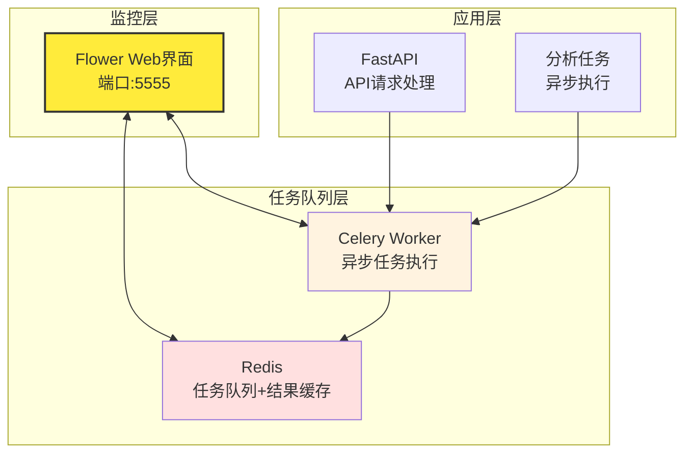
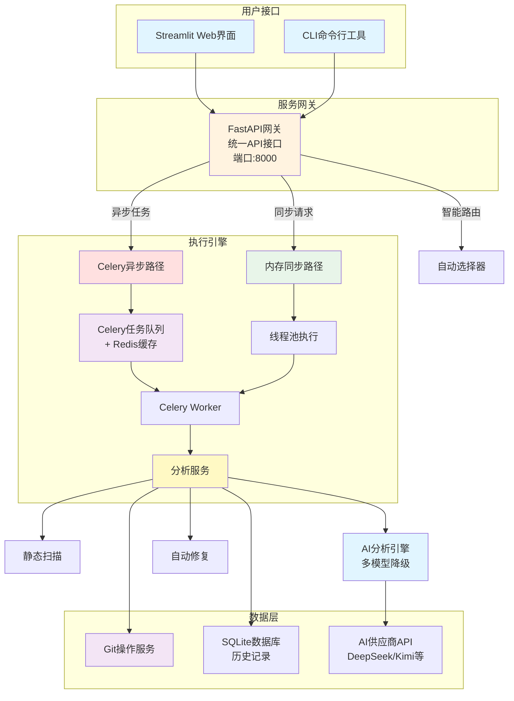
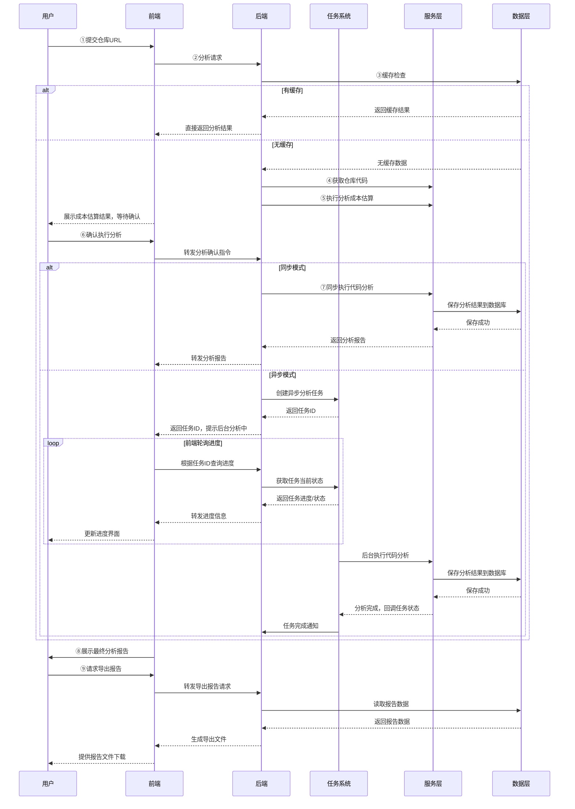
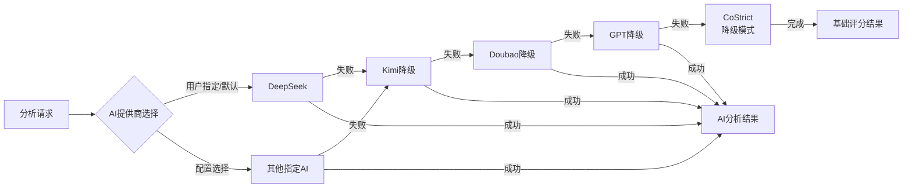
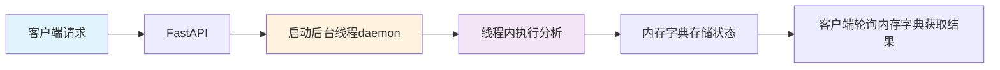
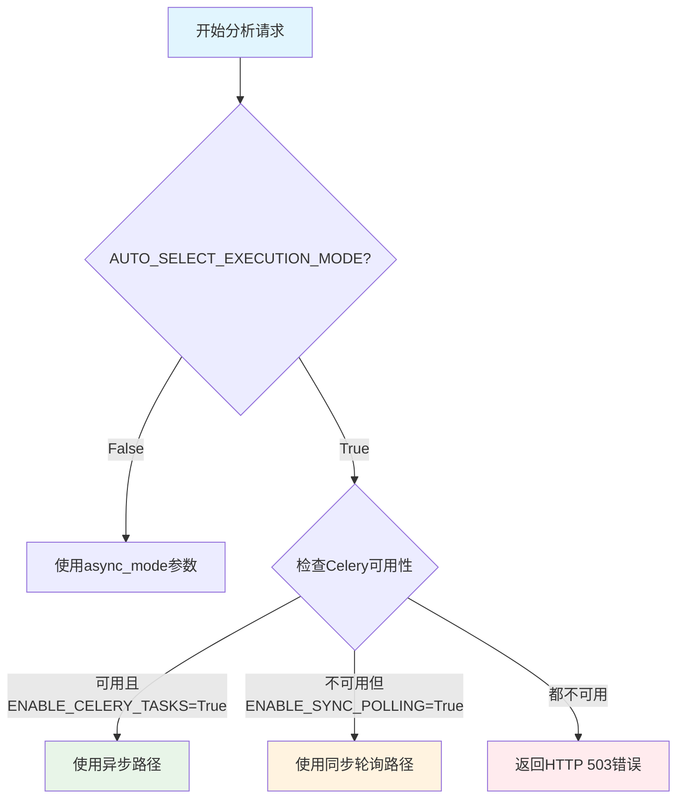
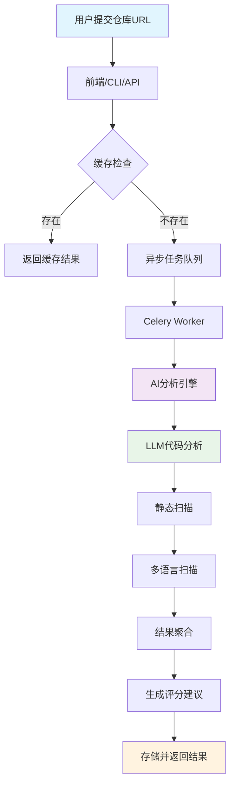

# CodePulse AI

基于 FastAPI 和 Streamlit 的开源项目健康诊断工具  
[English Version](README_en.md) | [中文版本](README.md)
[](https://github.com/zhouyanye/codepulse-ai/)
[](https://github.com/zhouyanye/codepulse-ai/blob/main/LICENSE)
[](https://www.python.org/downloads/)
[](https://github.com/psf/black)
[](https://github.com/zhouyanye/codepulse-ai/actions/workflows/python-test.yml)
[](https://github.com/zhouyanye/codepulse-ai/actions/workflows/code-quality.yml)
[](https://github.com/zhouyanye/codepulse-ai/actions/workflows/security-scan.yml)
[](https://github.com/zhouyanye/codepulse-ai/actions/workflows/docker.yml)
[](https://github.com/zhouyanye/codepulse-ai/wiki)
[](https://codepulse-ai.onrender.com)
[](https://github.com/zhouyanye/codepulse-ai/stargazers)

## 项目简介

CodePulse AI 是一个智能化的开源项目健康度评估系统，通过AI驱动的方式对GitHub和Gitee平台的开源项目进行全面分析。项目基于55份真实用户问卷调研，针对49.1%的开发者在评估开源项目时面临的"能力缺失"与"效率低下"双重困境而设计。

## 协作规范

我们鼓励社区参与和贡献！请查看以下文档了解如何参与项目：

- [贡献指南](CONTRIBUTING.md) - 了解如何报告问题、提交代码和参与讨论
- [行为准则](CODE_OF_CONDUCT.md) - 了解我们的社区行为规范
- [Issue模板](.github/ISSUE_TEMPLATE/) - 报告问题时使用合适的模板
- [Pull Request模板](.github/pull_request_template.md) - 提交代码时使用标准模板

### 核心功能

- **多维度健康评估**：从代码质量(30%)、安全漏洞(20%)、社区健康(20%)、文档完整性(15%)、维护活跃度(15%)五个维度综合评估项目健康度
- **AI驱动分析**：集成DeepSeek、Kimi、Doubao、OpenAI、CoStrict等主流AI服务商，提供智能代码审查和安全检测及AI 服务自动降级与切换
- **双路径执行架构**：
  - **异步路径**（推荐生产环境）：基于 Celery+Redis 的高性能异步任务队列，支持长时间分析任务的异步执行、进度实时跟踪与结果缓存
  - **同步轮询路径**（开发/测试环境）：基于后台线程的内存级任务管理，无需 Redis 即可支持异步风格的客户端轮询体验
  - **自动路径选择**：智能根据配置和 Redis 可用性自动选择最优执行路径，简化客户端使用
- **灵活配置控制**：通过环境变量精细控制各执行路径的启用/禁用，适配不同部署场景
- **全平台支持**：同时支持GitHub和Gitee两大代码托管平台，智能检测项目类型
- **历史记录持久化**：内置SQLite数据库支持，自动保存所有分析记录，支持历史回溯与趋势对比，无需额外部署复杂数据库
- **静态代码扫描**：支持多语言静态代码分析，自动识别安全漏洞和代码质量问题
- **成本预估**：基于Token消耗估算提供准确的AI调用成本预估
- **自动修复生成**：一键生成代码修复建议或Git Diff补丁，支持自动应用
- **可视化报告**：提供雷达图、仪表盘等可视化图表，支持Markdown和PDF格式导出
- **全场景灵活部署**：支持Web界面、CLI工具、REST API及Docker容器化部署，适配不同使用场景与集成需求

### 技术架构

- **后端**：FastAPI + Celery异步任务队列
- **前端**：Streamlit交互式Web界面
- **AI服务**：支持多个AI提供商的自动降级和备用机制
- **数据存储**：SQLite本地数据库 + Redis缓存
- **代码分析**：集成多种静态分析工具和AI代码审查

## 环境要求

- Python 3.10+
- Windows/Linux/macOS
- Git (用于代码仓库克隆，启动时会自动检测)
- Redis(可选): 7.0+（用于缓存和异步任务队列，若不使用异步功能可不安装）

## 快速开始

### 1. 克隆项目

```bash
git clone https://github.com/zhouyanye/codepulse-ai.git
cd codepulse-ai
```

### 2. 安装依赖

```bash
pip install -r requirements.txt -i https://pypi.tuna.tsinghua.edu.cn/simple --no-cache-dir
```

######  (可选) 安装wkhtmltopdf（PDF导出支持）

如需生成PDF报告，请根据系统从 [wkhtmltopdf官网](https://wkhtmltopdf.org/downloads.html) 下载对应版本安装：
```bash
# 验证安装（所有系统通用）
wkhtmltopdf --version
```

### 3. 配置环境变量

复制`.env.example`文件为`.env`并配置相关参数：

```bash
cp .env.example .env
```

在`.env`中配置至少一个AI服务提供商的API密钥：

```env
# AI服务配置（选择一个或多个）
DEEPSEEK_API_KEY=your_deepseekkey_here 
KIMI_API_KEY=your_kimikey_here #（推荐,新用户免费额度15元）
DOUBAO_API_KEY=your_doubaokey_here
OPENAI_API_KEY=your_openaikey_here

# Gitee/GitHub Token（私有仓库访问用）
GITEE_TOKEN=your_gitee_token
GITHUB_TOKEN=your_github_token

# Redis配置（异步功能需要）
REDIS_URL=redis://localhost:6379/0
REDIS_CACHE_TTL=86400
CELERY_BROKER_URL=redis://localhost:6379/0
CELERY_RESULT_BACKEND=redis://localhost:6379/0

# 执行模式
ENABLE_CELERY_TASKS=True
ENABLE_SYNC_POLLING=False
AUTO_SELECT_EXECUTION_MODE=True
```

**配置说明**：

- **AI 服务**：配置至少一个AI API密钥，否则自动使用CoStrict模式（仅基础评分）
- **访问 Token**：GitHub/Gitee Token可选，仅私有仓库需要
- **执行模式**：
  - 生产环境：`ENABLE_CELERY_TASKS=True, ENABLE_SYNC_POLLING=False, AUTO_SELECT_EXECUTION_MODE=True`
  - 开发环境：`ENABLE_CELERY_TASKS=False, ENABLE_SYNC_POLLING=True, AUTO_SELECT_EXECUTION_MODE=False`（无需Redis）
  - 测试：同时启用两种模式，手动选择

**配置示例**：

**生产环境**：
```env
ENABLE_CELERY_TASKS=True
ENABLE_SYNC_POLLING=False
AUTO_SELECT_EXECUTION_MODE=True
```

**开发环境**：
```env
ENABLE_CELERY_TASKS=False
ENABLE_SYNC_POLLING=True
AUTO_SELECT_EXECUTION_MODE=False
```

### 4. 启动后端服务

```bash
python run.py --component fastapi
```

后端服务将在 http://localhost:8000 启动，可通过以下地址访问：
- API文档：http://localhost:8000/docs
- ReDoc文档：http://localhost:8000/redoc

**开发模式配置**：
如需在开发过程中启用代码热重载功能（修改代码后自动重启服务），可直接使用 uvicorn 命令启动：
```bash
# 开发模式（带热重载）
uvicorn app.main:app --reload --host 0.0.0.0 --port 8000
```

### 5. 启动前端界面

新开一个终端窗口，执行：

```bash
python run.py --component streamlit
```

或直接使用Streamlit命令：

```bash
streamlit run web/main.py
```

前端界面将在 http://localhost:8501 启动

### 6. 启动Redis（可选）
若需要使用异步任务和缓存，请启动Redis服务：
```bash
# 使用Docker（推荐，跨系统）
docker run -d -p 6379:6379 redis:7-alpine

# Linux系统（系统服务）
sudo systemctl start redis-server

# Windows系统（直接启动）
redis-server.exe  # 需确保redis-server在环境变量中
# 或指定路径启动（示例）
# D:\redis-7.0.12\redis-server.exe
```

### 7. Flower监控（可选）
Flower 是 Celery 的实时监控工具，用于监控任务队列和工作进程状态：

**Flower监控架构图**：


**启动 Flower 监控**：
```bash
# 方法1：使用 Docker Compose（推荐）
docker-compose -f docker/docker-compose.yml up flower

# 方法2：直接启动
celery -A app.celery flower --port=5555 --debug
# 访问监控界面：http://localhost:5555
```

**监控功能**：
- 实时查看任务状态（进行中、已完成、失败）
- 监控 Celery Worker 性能
- 任务处理统计和历史记录
- 工作进程资源使用情况
#### 9：异步模式（推荐用于生产）

**启用 Celery 异步任务**（生产环境推荐）：
```bash
# 启动FastAPI后端（新终端）
python run.py --component fastapi

# 启动Celery Worker（新终端）
python run.py --component celery
```

**配置要求**：
- `.env` 中设置 `ENABLE_CELERY_TASKS=True`
- 确保 Redis 运行中（`REDIS_URL` 配置正确）
- 启动 Celery Worker 处理异步任务

**异步模式 API 端点**：
- 提交分析任务：`POST /api/v1/analyze/async`
- 查询任务状态：`GET /api/v1/analyze/status/{task_id}`

#### 10：同步轮询模式（无需 Redis，适合开发/测试）

**启用同步轮询任务**（开发环境推荐，无需 Redis）：
```bash
# 仅启动FastAPI后端即可
python run.py --component fastapi
```

**配置要求**：
- `.env` 和`config.py` 中设置 `ENABLE_SYNC_POLLING=True`
- 无需 Redis 和 Celery Worker

**同步轮询模式 API 端点**：
- 提交分析任务：`POST /api/v1/analyze/sync-polling`
- 查询任务状态：`GET /api/v1/analyze/polling-status/{task_id}`

#### 11：统一接口自动选择模式

**启用自动执行模式选择**（推荐用于简化客户端调用）：
```bash
# 启动FastAPI后端
python run.py --component fastapi

# 如果启用了 Celery，还需启动 Celery Worker
python run.py --component celery  # 可选，仅在启用 Celery 时需要
```

**配置要求**：
- `.env` 和`config.py` 中设置 `AUTO_SELECT_EXECUTION_MODE=True`
- 系统自动检测 Redis 可用性并选择最优执行路径

**统一接口端点**：
- 提交分析任务：`POST /api/v1/analyze`
- 查询任务状态：
  - 若为异步模式：`GET /api/v1/analyze/status/{task_id}`
  - 若为同步轮询模式：`GET /api/v1/analyze/polling-status/{task_id}`

#### 12：同时启动所有服务（推荐）

```bash
python run.py --component all
```

此命令将同时启动：
- FastAPI 后端服务
- Streamlit 前端界面
- Celery Worker（若 `ENABLE_CELERY_TASKS=True`）

## 使用说明

### Web界面使用

1. 访问 http://localhost:8501
2. 输入GitHub或Gitee仓库地址（例如：`https://gite.com/user/repository`）
3. 可选配置：
   - 选择AI服务提供商
   - 是否包含静态代码扫描
   - 输入私有仓库的访问Token(如env配置文件中配置可以忽略,当然也可以手动输入覆盖)
4. 点击"开始分析"按钮
5. 成本评估,用户是否进行继续分析
6. 等待分析完成（首次分析会克隆仓库，后续分析会使用缓存）
7. 查看多维度评估报告，包括：
   - 总体评分和各维度得分
   - 安全漏洞分析
   - 优化建议（按优先级分类）
   - 静态扫描结果
   - 代码修复建议
8. 导出报告为Markdown或PDF格式

### 命令行工具使用

项目提供了强大的CLI工具，支持批量分析和成本预估：

#### 分析单个仓库

```bash
# CLI帮助
python cli.py -h

# 分析GitHub仓库
python cli.py analyze https://github.com/user/repo --provider deepseek

# 分析私有Gitee仓库
python cli.py analyze https://gitee.com/user/repo --provider kimi --gitee-token your_token

# Token预估
python cli.py estimate https://github.com/user/repo --provider deepseek
```

#### 批量分析

创建一个文本文件`repos.txt`，每行一个仓库地址：

``txt
https://github.com/user/repo1
https://github.com/user/repo2
https://gitee.com/user/repo3
```

执行批量分析：

```bash
python cli.py batch repos.txt --provider deepseek --format json --output ./reports/
```

###  Docker一键部署
```bash
# 使用docker-compose启动所有服务（包括Redis、FastAPI、Celery Worker、Streamlit）
docker-compose -f docker/docker-compose.yml up -d
# 镜像加速
docker-compose -f docker/docker-compose.yml build --build-arg USE_CHINA_MIRROR=true
```

## 评分说明
项目健康度总分为100分，由以下五个维度加权计算得出：

| 评估维度 | 权重 | 说明 |
|----------|------|------|
| 代码质量 | 30% | 代码规范性、可维护性、复杂度 |
| 社区健康 | 20% | 社区活跃度、星标数、Fork数、贡献者 |
| 安全漏洞 | 20% | 安全漏洞和风险评估 |
| 文档完整 | 15% | 文档质量、README、许可证 |
| 维护活跃 | 15% | 项目维护频率、更新时间 |

总分计算公式（保留小数点后2位）：

$$
Score = Quality \times 0.3 + Community \times 0.2 + Security \times 0.2 + Documentation \times 0.15 + Maintenance \times 0.15
$$

### 评分解读

- **90-100分**：优秀的开源项目，代码质量高，社区活跃，文档完善
- **80-89分**：良好的项目，存在少量可改进之处
- **70-79分**：中等水平，需要关注安全问题和社区发展
- **60-69分**：一般项目，建议进行全面的代码审查和优化
- **60分以下**：存在较多问题，需要重点关注

**注意**：
- 如果安全评分较低（如32/100），说明存在严重安全风险，这是导致总体评分低的主要原因
- 如果社区评分较低（如35/100），说明项目社区活跃度不足（stars和forks较少）
- 如果文档评分一般（如55/100），说明文档有待提升
- **小项目/个人项目**：对于文件数较少的项目，系统会提供评分保护，确保因少量问题不会导致整体评分过低
- **知名项目**：对于stars数超过5000或stars>1000且forks>500的知名项目，系统会提供更高的评分保护，避免因少量低风险问题影响整体评分

## 系统架构

### 整体架构图



### 分析流程时序图



### AI服务降级机制




### 双路径执行架构

#### 设计理念

CodePulse AI 提供两条独立的代码执行路径，以适配不同的部署场景和使用需求：

| 特性 | 异步路径 (生产环境) | 同步轮询路径 (开发/测试) |
| :--- | :--- | :--- |
| **技术栈** | Celery + Redis | 后台线程 + 内存字典 |
| **依赖** | 需要安装 Redis | 零依赖 (开箱即用) |
| **适用场景** | 高并发、断点续传 | 快速演示、本地调试 |
| **性能** | ⭐⭐⭐⭐⭐ | ⭐⭐⭐ |


#### 架构对比

**异步路径架构**（推荐生产环境）：


**优点**：
- 高性能：支持大量并发任务，可水平扩展 Worker 数量
- 进度跟踪：实时任务进度更新，用户体验良好
- 结果缓存：Redis 缓存分析结果，避免重复计算
- 断点续传：支持任务中断后恢复
- 资源管理：Celery 自动管理 Worker 生命周期和资源

**缺点**：
- 依赖 Redis：需要额外部署 Redis 服务
- 架构复杂：涉及多个组件（FastAPI、Celery Worker、Redis）

**同步轮询路径架构**（推荐开发环境）：


**优点**：
- 零依赖：无需 Redis 和 Celery Worker
- 轻量快速：单进程运行，启动迅速
- 易于调试：所有执行过程在同一进程，日志集中
- 资源占用低：适合开发测试环境

**缺点**：
- 性能限制：受限于单机资源，无法水平扩展
- 内存存储：结果仅存在于内存中，重启丢失
- 进度限制：进度更新不如 Celery 实时

#### 自动路径选择

统一接口 `/api/v1/analyze` 实现了智能路径选择逻辑：



**配置建议**：

| 部署场景 | ENABLE_CELERY_TASKS | ENABLE_SYNC_POLLING | AUTO_SELECT_EXECUTION_MODE |
|---------|---------------------|---------------------|---------------------------|
| 生产环境 | True | False | True |
| 开发环境（有 Redis） | True | True | False |
| 开发环境（无 Redis） | False | True | False |
| 双路径测试 | True | True | False |

#### API 端点说明

**异步路径端点**：
- `POST /api/v1/analyze/async` - 提交异步分析任务
- `GET /api/v1/analyze/status/{task_id}` - 查询异步任务状态
- `GET /api/v1/analyze/result/{task_id}` - 获取异步任务结果

**同步轮询路径端点**：
- `POST /api/v1/analyze/sync-polling` - 提交同步轮询任务
- `GET /api/v1/analyze/polling-status/{task_id}` - 查询同步轮询任务状态
- `GET /api/v1/analyze/polling-result/{task_id}` - 获取同步轮询任务结果

**统一接口端点**：
- `POST /api/v1/analyze?async_mode=auto|true|sync_polling|false|sync_blocking` - 统一分析接口
  - `auto` - 自动选择（默认）
  - `true` - 强制使用异步路径
  - `sync_polling` - 强制使用同步轮询路径
  - `false` 或 `sync_blocking` - 强制使用同步阻塞模式

### 项目架构说明

#### 前端层 (Frontend Layer)
- **Streamlit Web界面**: [`web/main.py`](web/main.py:1) - 提供交互式Web界面，支持实时进度展示、可视化图表和报告导出
- **CLI命令行工具**: [`cli.py`](cli.py:1) - 支持批量分析、成本预估和自动化脚本

#### API层 (API Layer)
- **FastAPI后端**: [`app/main.py`](app/main.py:1) - RESTful API服务，提供统一的HTTP接口
- **API端点**: [`app/api/endpoints/analysis.py`](app/api/endpoints/analysis.py:1) - 处理分析请求、任务管理和结果查询

#### 任务队列层 (Task Queue Layer)
- **Celery Worker**: 异步执行长时间分析任务，支持进度跟踪
- **Redis缓存**: 缓存分析结果(24小时过期)，减少重复计算，同时作为Celery的消息代理

#### 业务逻辑层 (Business Logic Layer)
- **AnalysisService**: [`services/analysis_service.py`](services/analysis_service.py:1) - 核心分析服务，协调各模块
- **AIAnalyzer**: [`services/ai_analyzer.py`](services/ai_analyzer.py:1) - AI驱动的代码分析和评分
- **StaticScanService**: [`services/static_scan_service.py`](services/static_scan_service.py:1) - 多语言静态代码扫描
- **RecommendationService**: [`services/recommendation_service.py`](services/recommendation_service.py:1) - 优化建议生成
- **AutoFixService**: [`services/auto_fix_service.py`](services/auto_fix_service.py:1) - 自动修复和Diff生成

#### 数据访问层 (Data Access Layer)
- **GitHubService**: [`services/github_service.py`](services/github_service.py:1) - GitHub API集成
- **GiteeService**: [`services/gitee_service.py`](services/gitee_service.py:1) - Gitee API集成
- **GitUtils**: [`utils/git_utils.py`](utils/git_utils.py:1) - Git仓库克隆与缓存管理
- **SQLite数据库**: [`data/codepulse.db`](data/codepulse.db:1) - 持久化分析历史记录

#### AI服务层 (AI Services Layer)
- **AI服务降级机制**: [`utils/ai_client.py`](utils/ai_client.py:1) - 支持DeepSeek、Kimi、Doubao、OpenAI、CoStrict自动降级
- **成本估算**: [`utils/token_estimator.py`](utils/token_estimator.py:1) - 精确计算Token消耗和API成本

### 技术栈说明

#### 后端技术
- **FastAPI**: 现代高性能Python Web框架
- **Uvicorn**: ASGI服务器，支持异步处理
- **Celery**: 分布式任务队列
- **Redis**: 缓存和消息队列

#### 前端技术
- **Streamlit**: 快速构建数据应用
- **Pyecharts**: 可视化图表库(雷达图、仪表盘等)
- **Markdown2**: Markdown转HTML
- **pdfkit**: PDF生成

#### 数据库
- **SQLite**: 轻量级关系型数据库，用于存储分析历史
- **Redis**: 内存数据库，用于缓存和任务队列

#### 工具库
- **Pydantic**: 数据验证和序列化
- **Aiohttp**: 异步HTTP客户端
- **GitPython**: Git仓库操作

## 项目结构

```
codepulse-ai/
├── app/                    # FastAPI后端应用
│   ├── api/               # API路由
│   │   └── endpoints/     # 端点实现
│   ├── core/              # 核心配置
│   │   ├── config.py      # 应用配置
│   │   └── database.py    # 数据库配置
│   └── tasks/             # Celery异步任务
├── services/              # 业务逻辑服务
│   ├── analysis_service.py      # 分析服务
│   ├── ai_analyzer.py           # AI分析引擎
│   ├── github_service.py        # GitHub API服务
│   ├── gitee_service.py         # Gitee API服务
│   ├── code_quality_service.py  # 代码质量分析
│   ├── static_scan_service.py   # 静态代码扫描
│   ├── auto_fix_service.py      # 自动修复服务
│   ├── cost_estimation_service.py # 成本估算服务
│   └── recommendation_service.py # 推荐生成服务
├── models/                 # 数据模型
│   ├── analysis_models.py  # 分析结果模型
│   ├── request_models.py   # 请求模型
│   └── db_models.py        # 数据库模型
├── utils/                  # 工具函数
│   ├── ai_client.py        # AI客户端
│   ├── git_utils.py        # Git工具
│   ├── security_utils.py   # 安全工具
│   └── token_estimator.py  # Token估算器
├── web/                    # Streamlit前端
|   ├── i88n.py             # 国际化
│   ├── main.py             # 前端入口
├── tests/                  # 测试文件
├── docker/                 # Docker配置
├── docs/                   # 项目文档
│   ├── index.md            # 文档索引
│   ├── architecture.md     # 架构设计文档
│   ├── ai_analysis.md      # AI分析机制文档
│   ├── cost_estimation.md  # 成本估算机制文档
│   ├── configuration.md    # 配置与部署指南
│   └── cli_usage.md        # CLI工具使用指南
├── data/                   # 数据目录
├── .env.example           # 环境变量示例
├── requirements.txt       # 依赖列表
├── run.py                # 启动脚本
└── README.md             # 项目文档
```

### 数据流



## 核心功能详解

### AI驱动的静态代码扫描
- **多语言支持**：Python、JavaScript、Java、TypeScript、C#、Go等
- **智能问题识别**：代码异味、潜在漏洞、性能瓶颈、架构问题
- **批量处理**：大项目自动分批，避免API超限
- **JSON容错**：AI响应自动解析与错误恢复

### 异步任务与缓存
- **Celery任务队列**：将长时间分析任务异步化，支持进度查询
- **Redis缓存**：分析结果缓存（默认24小时），减少重复计算
- **任务状态API**：实时获取任务执行进度与结果

### 可视化仪表盘
- **健康度雷达图**：五维度评分可视化
- **安全漏洞详情**：高/中/低风险问题分层展示
- **优化建议优先级**：按紧急程度分类，提供具体修复代码
- **一键报告导出**：支持Markdown、PDF格式专业报告

## 常见问题

### 1. 如何获取GitHub Token？
请参考 [GitHub Token获取指南](#github-token获取指南)（见下文）。

### 2. 是否需要安装Redis？
根据配置决定：
- **启用 Celery 异步路径**（`ENABLE_CELERY_TASKS=True`）：必须安装 Redis，并启动 Celery Worker
- **仅启用同步轮询路径**（`ENABLE_CELERY_TASKS=False, ENABLE_SYNC_POLLING=True`）：无需 Redis
- **自动选择模式**（`AUTO_SELECT_EXECUTION_MODE=True`）：建议安装 Redis 以获得最佳性能，系统会自动降级到同步轮询路径

### 2.1. 如何在双路径架构中选择合适的配置？
根据部署场景选择：
- **生产环境**：启用异步路径，禁用同步轮询，启用自动选择（`ENABLE_CELERY_TASKS=True, ENABLE_SYNC_POLLING=False, AUTO_SELECT_EXECUTION_MODE=True`）
- **开发环境（有 Redis）**：同时启用双路径，禁用自动选择以手动测试（`ENABLE_CELERY_TASKS=True, ENABLE_SYNC_POLLING=True, AUTO_SELECT_EXECUTION_MODE=False`）
- **开发环境（无 Redis）**：仅启用同步轮询（`ENABLE_CELERY_TASKS=False, ENABLE_SYNC_POLLING=True, AUTO_SELECT_EXECUTION_MODE=False`）

### 3. 支持哪些AI模型？
目前支持 DeepSeek、Kimi、Doubao、OpenAI，可在 `.env` 中配置多个API Key，分析时选择使用。

### 4. 如何配置API Key？
1. 访问 https://platform.deepseek.com/sign_in
2. 创建一个DeepSeek账号
3. 创建一个API Key
4. 充值
> Kimi/Doubao/OpenAI 的 API Key 获取方式类似，分别访问其官方平台（[Kimi 开放平台](https://platform.moonshot.cn/) / [OpenAI 平台](https://platform.openai.com/)）注册并创建密钥。

### 5. 如何分析私有仓库？
在 `.env` 中配置有效的 `GITHUB_TOKEN` 或 `GITEE_TOKEN`（需包含 `repo` 权限），系统将自动使用Token访问私有仓库。

### 6. 如何扩展自定义分析规则？
可修改 `utils/costrict.py` 中的规则引擎(只简单评分)，或扩展 `services/ai_analyzer.py` 中的提示词模板。

## GitHub Token获取指南

### 步骤
1. 登录GitHub，点击右上角头像 → **Settings**
2. 左侧菜单 → **Developer settings** → **Personal access tokens** → **Tokens (classic)**
3. 点击 **Generate new token**，填写Note（如“CodePulse AI”），选择有效期（建议90天）
4. 勾选权限：`repo`（必需）、`read:org`、`read:user`
5. 点击 **Generate token**，**立即复制生成的Token**（此Token只显示一次）
6. 将Token填入 `.env` 文件的 `GITHUB_TOKEN` 变量中

>  **安全提醒**：请勿将Token提交到代码仓库或分享给他人！

## 安全策略

我们非常重视项目安全性。如果您发现安全漏洞，请按照 [SECURITY.md](.github/SECURITY.md) 中的指南进行报告。

## 贡献指南

欢迎贡献代码！请阅读[CONTRIBUTING.md](CONTRIBUTING.md)了解详细信息。

我们鼓励社区参与和贡献！请查看以下文档了解如何参与项目：

- [贡献指南](CONTRIBUTING.md) - 了解如何报告问题、提交代码和参与讨论
- [行为准则](CODE_OF_CONDUCT.md) - 了解我们的社区行为规范
- [Issue模板](.github/ISSUE_TEMPLATE/) - 报告问题时使用合适的模板
- [Pull Request模板](.github/pull_request_template.md) - 提交代码时使用标准模板

## 许可证

本项目采用MIT许可证。详见[LICENSE](LICENSE)文件。

## 协作与贡献
本项目为个人参赛作品，由 YanLeaf AI Lab 开发维护。我们欢迎任何形式的反馈与建议：
- 如有问题或想法，请通过 [GitHub Issues](https://github.com/zhouyanye/codepulse-ai/issues) 提出。
- 未来项目开源后，将完善贡献指南。
- 特别感谢 CoStrict AI 编程助手在本项目架构设计与代码重构中提供的支持
## 联系我们

- **项目主页**: [https://github.com/zhouyanye/codepulse-ai/](https://github.com/zhouyanye/codepulse-ai/)
- **开发团队**: YanLeaf AI Lab
- **问题反馈**: [GitHub Issues](https://github.com/zhouyanye/codepulse-ai/issues)
- **功能建议**: [GitHub Discussions](https://github.com/zhouyanye/codepulse-ai/discussions)
- **邮件联系**: [yanleaf@yanleaf.com](mailto:yanleaf@yanleaf.com)

## 详细文档

需要了解更多技术细节？请查看我们的详细文档：
- [架构设计](docs/architecture.md) - 系统架构和组件设计
- [AI分析机制](docs/ai_analysis.md) - AI分析流程和机制详解
- [成本估算机制](docs/cost_estimation.md) - 成本估算原理和定价模型
- [配置与部署指南](docs/configuration.md) - 详细配置和部署说明
- [CLI工具使用指南](docs/cli_usage.md) - 命令行工具详细用法

## 致谢

本项目在开发过程中得到了以下开源项目和工具的启发和支持：

特别感谢 CoStrict AI 编程助手在本项目架构设计与代码重构中提供的支持
- FastAPI：高性能的Python Web框架
- Streamlit：快速构建数据应用的Python库
- Pydantic：数据验证和设置管理
- FastGit：提供GitHub镜像加速服务，提升仓库克隆速度
- CoStrict：AI编程助手，在项目编码过程中提供协助
---
<div align="center">

**⭐ 如果这个项目对您有帮助，请给我们一个Star！**

[](https://star-history.com/#zhouyanye/codepulse-ai&Date)

</div>

---

**CodePulse AI** - 让开源项目健康评估更智能