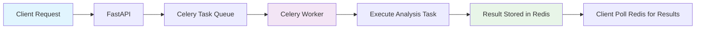
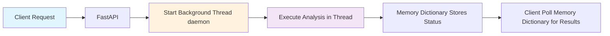
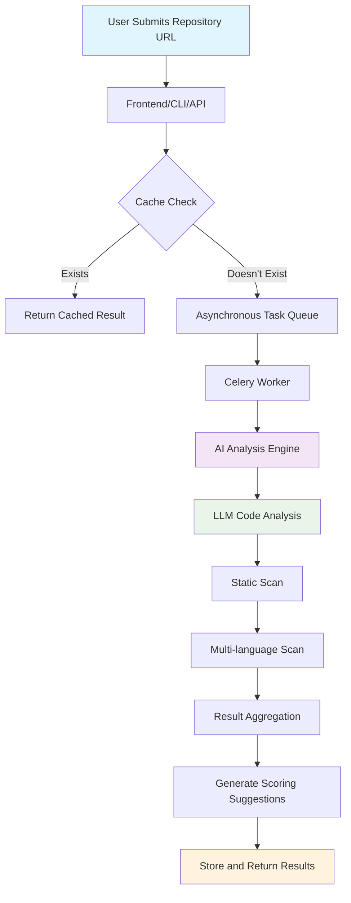

# CodePulse AI

Open Source Project Health Diagnostic Tool Based on FastAPI and Streamlit  
[English Version](README_en.md) | [中文版本](README.md)
[](https://github.com/zhouyanye/codepulse-ai/)
[](https://github.com/zhouyanye/codepulse-ai/blob/main/LICENSE)
[](https://www.python.org/downloads/)
[](https://github.com/psf/black)
[](https://github.com/zhouyanye/codepulse-ai/actions/workflows/python-test.yml)
[](https://github.com/zhouyanye/codepulse-ai/actions/workflows/code-quality.yml)
[](https://github.com/zhouyanye/codepulse-ai/actions/workflows/security-scan.yml)
[](https://github.com/zhouyanye/codepulse-ai/actions/workflows/docker.yml)
[](https://github.com/zhouyanye/codepulse-ai/wiki)
[](https://codepulse-ai.onrender.com)
[](https://github.com/zhouyanye/codepulse-ai/stargazers)

## Project Introduction

CodePulse AI is an intelligent open source project health assessment system that provides comprehensive analysis of open source projects on GitHub and Gitee platforms through AI-driven methods. The project is based on 55 real user questionnaires and is designed to address the "capability gap" and "inefficiency" challenges faced by 49.1% of developers when evaluating open source projects.

## Collaboration Guidelines

We encourage community participation and contributions! Please check the following documents to learn how to participate in the project:

- [Contributing Guide](CONTRIBUTING.md) - Learn how to report issues, submit code, and participate in discussions
- [Code of Conduct](CODE_OF_CONDUCT.md) - Learn about our community conduct guidelines
- [Issue Templates](.github/ISSUE_TEMPLATE/) - Use appropriate templates when reporting issues
- [Pull Request Template](.github/pull_request_template.md) - Use standard templates when submitting code

### Core Features

- **Multi-dimensional Health Assessment**: Comprehensive evaluation of project health from five dimensions: code quality (30%), security vulnerabilities (20%), community health (20%), documentation completeness (15%), and maintenance activity (15%)
- **AI-driven Analysis**: Integrates mainstream AI service providers such as DeepSeek, Kimi, Doubao, OpenAI, CoStrict, providing intelligent code review and security detection with automatic AI service downgrade and switching
- **Dual Path Execution Architecture**:
  - **Asynchronous Path** (recommended for production): High-performance asynchronous task queue based on Celery+Redis, supporting asynchronous execution of long-running analysis tasks, real-time progress tracking, and result caching
  - **Synchronous Polling Path** (development/testing environment): Memory-level task management based on background threads, supporting asynchronous-style client polling experience without Redis
  - **Automatic Path Selection**: Intelligent selection of optimal execution path based on configuration and Redis availability, simplifying client usage
- **Flexible Configuration Control**: Fine-grained control of enabling/disabling execution paths through environment variables, adapting to different deployment scenarios
- **Full Platform Support**: Simultaneously supports GitHub and Gitee, the two major code hosting platforms, with intelligent project type detection
- **Persistent History Records**: Built-in SQLite database support, automatically saving all analysis records, supporting historical review and trend comparison, without requiring additional deployment of complex databases
- **Static Code Scanning**: Multi-language static code analysis support, automatically identifying security vulnerabilities and code quality issues
- **Cost Estimation**: Accurate AI call cost estimation based on Token consumption
- **Automatic Fix Generation**: One-click generation of code fix suggestions or Git Diff patches, supporting automatic application
- **Visual Reports**: Provides radar charts, dashboards, and other visual charts, supporting Markdown and PDF format export
- **Flexible Deployment for All Scenarios**: Supports Web interface, CLI tools, REST API, and Docker containerized deployment, adapting to different usage scenarios and integration requirements

### Technical Architecture

- **Backend**: FastAPI + Celery asynchronous task queue
- **Frontend**: Streamlit interactive web interface
- **AI Services**: Automatic downgrade and backup mechanisms for multiple AI providers
- **Data Storage**: SQLite local database + Redis cache
- **Code Analysis**: Integration of multiple static analysis tools and AI code review

## Environment Requirements

- Python 3.10+
- Windows/Linux/macOS
- Git (for code repository cloning, automatically detected at startup)
- Redis (optional): 7.0+ (for caching and asynchronous task queues, not required if not using asynchronous features)

## Quick Start

### 1. Clone Project

```bash
git clone https://github.com/zhouyanye/codepulse-ai.git
cd codepulse-ai
```

### 2. Install Dependencies

```bash
pip install -r requirements.txt -i https://pypi.tuna.tsinghua.edu.cn/simple --no-cache-dir
```

###### (Optional) Install wkhtmltopdf (PDF export support)

To generate PDF reports, download the corresponding version from [wkhtmltopdf official website](https://wkhtmltopdf.org/downloads.html) according to your system:
```bash
# Verify installation (universal for all systems)
wkhtmltopdf --version
```

### 3. Configure Environment Variables

Copy the `.env.example` file to `.env` and configure the relevant parameters:

```bash
cp .env.example .env
```

Configure at least one AI service provider API key in `.env`:

```env
# AI Service Configuration (choose one or more)
DEEPSEEK_API_KEY=your_deepseek_api_key_here 
KIMI_API_KEY=your_kimi_api_key_here # (recommended, new user free quota 15 CNY)
DOUBAO_API_KEY=your_doubao_api_key_here
OPENAI_API_KEY=your_openai_api_key_here

# Gitee/GitHub Token (for private repository access)
GITEE_TOKEN=your_gitee_token
GITHUB_TOKEN=your_github_token

# Redis Configuration (for asynchronous features)
REDIS_URL=redis://localhost:6379/0
REDIS_CACHE_TTL=86400
CELERY_BROKER_URL=redis://localhost:6379/0
CELERY_RESULT_BACKEND=redis://localhost:6379/0

# Execution Mode
ENABLE_CELERY_TASKS=True
ENABLE_SYNC_POLLING=False
AUTO_SELECT_EXECUTION_MODE=True
```

**Configuration Notes**:

- **AI Services**: Configure at least one AI API key, otherwise CoStrict mode will be used automatically (basic scoring only)
- **Access Tokens**: GitHub/Gitee tokens are optional, only required for private repositories
- **Execution Mode**:
  - Production environment: `ENABLE_CELERY_TASKS=True, ENABLE_SYNC_POLLING=False, AUTO_SELECT_EXECUTION_MODE=True`
  - Development environment: `ENABLE_CELERY_TASKS=False, ENABLE_SYNC_POLLING=True, AUTO_SELECT_EXECUTION_MODE=False` (no Redis required)
  - Testing: Enable both modes simultaneously, manual selection

**Configuration Examples**:

**Production Environment**:
```env
ENABLE_CELERY_TASKS=True
ENABLE_SYNC_POLLING=False
AUTO_SELECT_EXECUTION_MODE=True
```

**Development Environment**:
```env
ENABLE_CELERY_TASKS=False
ENABLE_SYNC_POLLING=True
AUTO_SELECT_EXECUTION_MODE=False
```

### 4. Start Backend Service

```bash
python run.py --component fastapi
```

The backend service will start at http://localhost:8000 and can be accessed at the following addresses:
- API Documentation: http://localhost:8000/docs
- ReDoc Documentation: http://localhost:8000/redoc

**Development Mode Configuration**:
To enable code hot reload functionality during development (automatically restart service after code changes), you can directly use the uvicorn command:
```bash
# Development mode (with hot reload)
uvicorn app.main:app --reload --host 0.0.0.0 --port 8000
```

### 5. Start Frontend Interface

Open a new terminal window and execute:

```bash
python run.py --component streamlit
```

Or directly use the Streamlit command:

```bash
streamlit run web/main.py
```

The frontend interface will start at http://localhost:8501

### 6. Start Redis (Optional)
To use asynchronous tasks and caching, start the Redis service:
```bash
# Using Docker (recommended, cross-platform)
docker run -d -p 6379:6379 redis:7-alpine

# Linux system (system service)
sudo systemctl start redis-server

# Windows system (direct start)
redis-server.exe  # Ensure redis-server is in environment variables
# Or specify path to start (example)
# D:\redis-7.0.12\redis-server.exe
```

### 7. Flower Monitoring (Optional)
Flower is a real-time monitoring tool for Celery, used to monitor task queues and worker processes:

**Flower Monitoring Architecture**:
``mermaid
graph TB
    subgraph "Monitoring Layer"
        FLOWER[Flower Web Interface<br/>Port:5555]
    end
    
    subgraph "Task Queue Layer"
        CELERY[Celery Worker<br/>Asynchronous Task Execution]
        REDIS[Redis<br/>Task Queue+Result Cache]
    end
    
    subgraph "Application Layer"
        FASTAPI[FastAPI<br/>API Request Processing]
        TASKS[Analysis Tasks<br/>Asynchronous Execution]
    end
    
    FLOWER <--> REDIS
    FLOWER <--> CELERY
    FASTAPI --> CELERY
    CELERY --> REDIS
    TASKS --> CELERY
    
    style FLOWER fill:#ffeb3b,stroke:#333,stroke-width:2px
    style REDIS fill:#ffe0e0
    style CELERY fill:#fff3e0
```

**Start Flower Monitoring**:
```bash
# Method 1: Using Docker Compose (recommended)
docker-compose -f docker/docker-compose.yml up flower

# Method 2: Direct start
celery -A app.celery flower --port=5555 --debug
# Access monitoring interface: http://localhost:5555
```

**Monitoring Features**:
- Real-time view of task status (in progress, completed, failed)
- Monitor Celery Worker performance
- Task processing statistics and history
- Worker process resource usage

#### 9: Asynchronous Mode (Recommended for Production)

**Enable Celery Asynchronous Tasks** (recommended for production environment):
```bash
# Start FastAPI backend (new terminal)
python run.py --component fastapi

# Start Celery Worker (new terminal)
python run.py --component celery
```

**Configuration Requirements**:
- Set `ENABLE_CELERY_TASKS=True` in `.env`
- Ensure Redis is running (`REDIS_URL` configured correctly)
- Start Celery Worker to process asynchronous tasks

**Asynchronous Mode API Endpoints**:
- Submit analysis task: `POST /api/v1/analyze/async`
- Query task status: `GET /api/v1/analyze/status/{task_id}`

#### 10: Synchronous Polling Mode (No Redis Required, Suitable for Development/Testing)

**Enable Synchronous Polling Tasks** (recommended for development environment, no Redis required):
```bash
# Start FastAPI backend only
python run.py --component fastapi
```

**Configuration Requirements**:
- Set `ENABLE_SYNC_POLLING=True` in `.env` and `config.py`
- No Redis or Celery Worker required

**Synchronous Polling Mode API Endpoints**:
- Submit analysis task: `POST /api/v1/analyze/sync-polling`
- Query task status: `GET /api/v1/analyze/polling-status/{task_id}`

#### 11: Unified Interface Auto-Selection Mode

**Enable Automatic Execution Mode Selection** (recommended for simplifying client calls):
```bash
# Start FastAPI backend
python run.py --component fastapi

# If Celery is enabled, also start Celery Worker
python run.py --component celery  # Optional, only required when Celery is enabled
```

**Configuration Requirements**:
- Set `AUTO_SELECT_EXECUTION_MODE=True` in `.env` and `config.py`
- System automatically detects Redis availability and selects optimal execution path

**Unified Interface Endpoints**:
- Submit analysis task: `POST /api/v1/analyze`
- Query task status:
  - If asynchronous mode: `GET /api/v1/analyze/status/{task_id}`
  - If synchronous polling mode: `GET /api/v1/analyze/polling-status/{task_id}`

#### 12: Start All Services Simultaneously (Recommended)

```bash
python run.py --component all
```

This command will start simultaneously:
- FastAPI backend service
- Streamlit frontend interface
- Celery Worker (if `ENABLE_CELERY_TASKS=True`)

## Usage Instructions

### Web Interface Usage

1. Access http://localhost:8501
2. Input GitHub or Gitee repository address (e.g., `https://gite.com/user/repository`)
3. Optional configurations:
   - Select AI service provider
   - Whether to include static code scanning
   - Input access token for private repositories (if configured in env file, can be ignored, or manually input to override)
4. Click "Start Analysis" button
5. Cost evaluation, user decides whether to continue analysis
6. Wait for analysis completion (first analysis will clone repository, subsequent analysis will use cache)
7. View multi-dimensional assessment report, including:
   - Overall score and scores for each dimension
   - Security vulnerability analysis
   - Optimization suggestions (categorized by priority)
   - Static scan results
   - Code fix suggestions
8. Export report in Markdown or PDF format

### Command Line Tool Usage

The project provides a powerful CLI tool supporting batch analysis and cost estimation:

#### Analyze Single Repository

```bash
# CLI help
python cli.py -h

# Analyze GitHub repository
python cli.py analyze https://github.com/user/repo --provider deepseek

# Analyze private Gitee repository
python cli.py analyze https://gitee.com/user/repo --provider kimi --gitee-token your_token

# Token estimation
python cli.py estimate https://github.com/user/repo --provider deepseek
```

#### Batch Analysis

Create a text file `repos.txt`, one repository address per line:

``txt
https://github.com/user/repo1
https://github.com/user/repo2
https://gitee.com/user/repo3
```

Execute batch analysis:

```bash
python cli.py batch repos.txt --provider deepseek --format json --output ./reports/
```

### Docker One-Click Deployment
```bash
# Use docker-compose to start all services (including Redis, FastAPI, Celery Worker, Streamlit)
docker-compose -f docker/docker-compose.yml up -d
# Image acceleration
docker-compose -f docker/docker-compose.yml build --build-arg USE_CHINA_MIRROR=true
```

## Scoring Explanation
The project health score is out of 100 points, calculated by weighted sum of the following five dimensions:

| Assessment Dimension | Weight | Description |
|----------------------|--------|-------------|
| Code Quality | 30% | Code standardization, maintainability, complexity |
| Community Health | 20% | Community activity, stars, forks, contributors |
| Security Vulnerabilities | 20% | Security vulnerabilities and risk assessment |
| Documentation Completeness | 15% | Documentation quality, README, license |
| Maintenance Activity | 15% | Project maintenance frequency, update time |

Total score calculation formula (retaining 2 decimal places):

$$
Score = Quality \times 0.3 + Community \times 0.2 + Security \times 0.2 + Documentation \times 0.15 + Maintenance \times 0.15
$$

### Scoring Interpretation

- **90-100 points**: Excellent open source project, high code quality, active community, complete documentation
- **80-89 points**: Good project, with minor areas for improvement
- **70-79 points**: Medium level, needs attention to security issues and community development
- **60-69 points**: General project, recommended for comprehensive code review and optimization
- **Below 60 points**: Many issues, needs significant attention

**Note**:
- If the security score is low (e.g., 32/100), it indicates serious security risks, which is the main reason for the low overall score
- If the community score is low (e.g., 35/100), it indicates insufficient community activity (few stars and forks)
- If the documentation score is average (e.g., 55/100), it indicates documentation needs improvement
- **Small Projects/Personal Projects**: For projects with fewer files, the system provides scoring protection to ensure that a few issues don't result in an overly low overall score
- **Well-known Projects**: For projects with more than 5000 stars or stars > 1000 and forks > 500, the system provides higher scoring protection to avoid affecting the overall score due to a few low-risk issues

## System Architecture

### Overall Architecture

``mermaid
graph TB
    subgraph "User Interface"
        WEB[Streamlit Web Interface]
        CLI[CLI Command Line Tool]
    end
    
    subgraph "Service Gateway"
        API[FastAPI Gateway<br/>Unified API Interface<br/>Port:8000]
    end
    
    API -->|Asynchronous Task| ASYNC[Celery Asynchronous Path]
    API -->|Synchronous Request| SYNC[Memory Synchronous Path]
    API -->|Smart Routing| AUTO[Auto Selector]
    
    subgraph "Execution Engine"
        ASYNC --> TASK[Celery Task Queue<br/>+ Redis Cache]
        SYNC --> THREAD[Thread Pool Execution]
        
        TASK --> WORKER[Celery Worker]
        THREAD --> WORKER
        
        WORKER --> SERVICE[Analysis Service]
    end
    
    SERVICE --> SCAN[Static Scan]
    SERVICE --> AI[AI Analysis Engine<br/>Multi-model Downgrade]
    SERVICE --> FIX[Auto Fix]
    
    subgraph "Data Layer"
        GIT[Git Operation Service]
        DB[SQLite Database<br/>History Records]
        AI_API[AI Provider API<br/>DeepSeek/Kimi, etc.]
    end
    
    WEB --> API
    CLI --> API
    
    SERVICE --> GIT
    SERVICE --> DB
    AI --> AI_API
    
    style WEB fill:#e1f5ff
    style CLI fill:#e1f5ff
    style API fill:#fff3e0
    style ASYNC fill:#ffe0e0
    style SYNC fill:#e8f5e9
    style TASK fill:#f3e5f5
    style SERVICE fill:#fff9c4
    style AI fill:#e1f5ff
    style GIT fill:#f3e5f5
```

### Analysis Flow Sequence Diagram

``mermaid
sequenceDiagram
    participant U as User
    participant F as Frontend
    participant B as Backend
    participant T as Task System
    participant S as Service Layer
    participant D as Data Layer

    U->>F: ①Submit Repository URL
    F->>B: ②Analysis Request
    
    B->>D: ③Cache Check
    alt Has Cache
        D-->>B: Return Cached Result
        B-->>F: Directly Return Analysis Result
    else No Cache
        D-->>B: No Cache Data
        
        B->>S: ④Get Repository Code
        B->>S: ⑤Execute Analysis Cost Estimation
        F-->>U: Display Cost Estimation Result, Wait for Confirmation
        
        U->>F: ⑥Confirm Execute Analysis
        F->>B: Forward Analysis Confirmation Command
        
        alt Synchronous Mode
            B->>S: ⑦Synchronously Execute Code Analysis
            S->>D: Save Analysis Result to Database
            D-->>S: Save Successful
            S-->>B: Return Analysis Report
            B-->>F: Forward Analysis Report
        else Asynchronous Mode
            B->>T: Create Asynchronous Analysis Task
            T-->>B: Return Task ID
            B-->>F: Return Task ID, Prompt Background Analysis in Progress
            
            loop Frontend Poll Progress
                F->>B: Query Progress by Task ID
                B->>T: Get Current Task Status
                T-->>B: Return Task Progress/Status
                B-->>F: Forward Progress Information
                F-->>U: Update Progress Interface
            end
            
            T->>S: Background Execute Code Analysis
            S->>D: Save Analysis Result to Database
            D-->>S: Save Successful
            S-->>T: Analysis Complete, Callback Task Status
            T->>B: Task Complete Notification
        end
    end
    
    F->>U: ⑧Display Final Analysis Report
    U->>F: ⑨Request Export Report
    F->>B: Forward Export Report Request
    B->>D: Read Report Data
    D-->>B: Return Report Data
    B-->>F: Generate Export File
    F-->>U: Provide Report File Download
```

### AI Service Downgrade Mechanism

``mermaid
graph LR
    Start[Analysis Request] --> Select{AI Provider Selection}
    Select -->|User Specified/Default| DeepSeek[DeepSeek]
    Select -->|Configuration Selection| Direct[Other Specified AI]
    
    DeepSeek -->|Failure| Kimi[Kimi Downgrade]
    Direct -->|Failure| Kimi
    
    Kimi -->|Failure| Doubao[Doubao Downgrade]
    Doubao -->|Failure| OpenAI[GPT Downgrade]
    OpenAI -->|Failure| Fallback[CoStrict<br/>Downgrade Mode]
    
    DeepSeek -->|Success| Result[AI Analysis Result]
    Direct -->|Success| Result
    Kimi -->|Success| Result
    Doubao -->|Success| Result
    OpenAI -->|Success| Result
    Fallback -->|Complete| Basic[Basic Scoring Result]
```


### Dual Path Execution Architecture

#### Design Philosophy

CodePulse AI provides two independent code execution paths to accommodate different deployment scenarios and usage requirements:

| Feature | Asynchronous Path (Production Environment) | Synchronous Polling Path (Development/Testing) |
| :--- | :--- | :--- |
| **Technology Stack** | Celery + Redis | Background Thread + Memory Dictionary |
| **Dependencies** | Requires Redis Installation | Zero Dependencies (Out of the Box) |
| **Applicable Scenarios** | High Concurrency, Resume from Breakpoint | Quick Demo, Local Debugging |
| **Performance** | ⭐⭐⭐⭐⭐ | ⭐⭐⭐ |


#### Architecture Comparison

**Asynchronous Path Architecture** (recommended for production environment):


**Advantages**:
- High Performance: Supports large number of concurrent tasks, can scale Worker count horizontally
- Progress Tracking: Real-time task progress updates, good user experience
- Result Caching: Redis caches analysis results, avoids duplicate calculations
- Resume from Breakpoint: Supports task recovery after interruption
- Resource Management: Celery automatically manages Worker lifecycle and resources

**Disadvantages**:
- Redis Dependency: Requires additional Redis service deployment
- Complex Architecture: Involves multiple components (FastAPI, Celery Worker, Redis)

**Synchronous Polling Path Architecture** (recommended for development environment):


**Advantages**:
- Zero Dependencies: No Redis or Celery Worker required
- Lightweight and Fast: Single process operation, quick startup
- Easy Debugging: All execution processes in same process, centralized logs
- Low Resource Usage: Suitable for development and testing environments

**Disadvantages**:
- Performance Limitations: Limited by single machine resources, cannot scale horizontally
- Memory Storage: Results only exist in memory, lost after restart
- Progress Limitations: Progress updates not as real-time as Celery

#### Automatic Path Selection

Unified interface `/api/v1/analyze` implements intelligent path selection logic:

``mermaid
flowchart TD
    A[Start Analysis Request] --> B{AUTO_SELECT_EXECUTION_MODE?}
    B -->|False| C[Use async_mode Parameter]
    B -->|True| D{Check Celery Availability}
    D -->|Available and ENABLE_CELERY_TASKS=True| E[Use Asynchronous Path]
    D -->|Unavailable but ENABLE_SYNC_POLLING=True| F[Use Synchronous Polling Path]
    D -->|Both Unavailable| G[Return HTTP 503 Error]
    
    style A fill:#e1f5fe
    style E fill:#e8f5e8
    style F fill:#fff3e0
    style G fill:#ffebee
```

**Configuration Recommendations**:

| Deployment Scenario | ENABLE_CELERY_TASKS | ENABLE_SYNC_POLLING | AUTO_SELECT_EXECUTION_MODE |
|---------|---------------------|---------------------|---------------------------|
| Production Environment | True | False | True |
| Development Environment (with Redis) | True | True | False |
| Development Environment (without Redis) | False | True | False |
| Dual Path Testing | True | True | False |

#### API Endpoints Explanation

**Asynchronous Path Endpoints**:
- `POST /api/v1/analyze/async` - Submit asynchronous analysis task
- `GET /api/v1/analyze/status/{task_id}` - Query asynchronous task status
- `GET /api/v1/analyze/result/{task_id}` - Get asynchronous task results

**Synchronous Polling Path Endpoints**:
- `POST /api/v1/analyze/sync-polling` - Submit synchronous polling task
- `GET /api/v1/analyze/polling-status/{task_id}` - Query synchronous polling task status
- `GET /api/v1/analyze/polling-result/{task_id}` - Get synchronous polling task results

**Unified Interface Endpoints**:
- `POST /api/v1/analyze?async_mode=auto|true|sync_polling|false|sync_blocking` - Unified analysis interface
  - `auto` - Automatic selection (default)
  - `true` - Force asynchronous path
  - `sync_polling` - Force synchronous polling path
  - `false` or `sync_blocking` - Force synchronous blocking mode

### Project Architecture Explanation

#### Frontend Layer (Frontend Layer)
- **Streamlit Web Interface**: [`web/main.py`](web/main.py:1) - Provides interactive web interface, supports real-time progress display, visual charts, and report export
- **CLI Command Line Tool**: [`cli.py`](cli.py:1) - Supports batch analysis, cost estimation, and automation scripts

#### API Layer (API Layer)
- **FastAPI Backend**: [`app/main.py`](app/main.py:1) - RESTful API service, provides unified HTTP interface
- **API Endpoints**: [`app/api/endpoints/analysis.py`](app/api/endpoints/analysis.py:1) - Handles analysis requests, task management, and result queries

#### Task Queue Layer (Task Queue Layer)
- **Celery Worker**: Asynchronously executes long-running analysis tasks, supports progress tracking
- **Redis Cache**: Caches analysis results (24-hour expiration), reduces duplicate calculations, and serves as Celery message broker

#### Business Logic Layer (Business Logic Layer)
- **AnalysisService**: [`services/analysis_service.py`](services/analysis_service.py:1) - Core analysis service, coordinates various modules
- **AIAnalyzer**: [`services/ai_analyzer.py`](services/ai_analyzer.py:1) - AI-driven code analysis and scoring
- **StaticScanService**: [`services/static_scan_service.py`](services/static_scan_service.py:1) - Multi-language static code scanning
- **RecommendationService**: [`services/recommendation_service.py`](services/recommendation_service.py:1) - Optimization suggestion generation
- **AutoFixService**: [`services/auto_fix_service.py`](services/auto_fix_service.py:1) - Automatic fix and Diff generation

#### Data Access Layer (Data Access Layer)
- **GitHubService**: [`services/github_service.py`](services/github_service.py:1) - GitHub API integration
- **GiteeService**: [`services/gitee_service.py`](services/gitee_service.py:1) - Gitee API integration
- **GitUtils**: [`utils/git_utils.py`](utils/git_utils.py:1) - Git repository cloning and cache management
- **SQLite Database**: [`data/codepulse.db`](data/codepulse.db:1) - Persistent analysis history records

#### AI Service Layer (AI Services Layer)
- **AI Service Downgrade Mechanism**: [`utils/ai_client.py`](utils/ai_client.py:1) - Supports automatic downgrade for DeepSeek, Kimi, Doubao, OpenAI, CoStrict
- **Cost Estimation**: [`utils/token_estimator.py`](utils/token_estimator.py:1) - Precise calculation of Token consumption and API costs

### Technology Stack Explanation

#### Backend Technologies
- **FastAPI**: Modern high-performance Python web framework
- **Uvicorn**: ASGI server, supports asynchronous processing
- **Celery**: Distributed task queue
- **Redis**: Cache and message queue

#### Frontend Technologies
- **Streamlit**: Rapidly build data applications
- **Pyecharts**: Visualization chart library (radar chart, dashboard, etc.)
- **Markdown2**: Markdown to HTML
- **pdfkit**: PDF generation

#### Database
- **SQLite**: Lightweight relational database for storing analysis history
- **Redis**: In-memory database for caching and task queues

#### Tool Libraries
- **Pydantic**: Data validation and serialization
- **Aiohttp**: Asynchronous HTTP client
- **GitPython**: Git repository operations

## Project Structure

```
codepulse-ai/
├── app/                    # FastAPI Backend Application
│   ├── api/               # API Routes
│   │   └── endpoints/     # Endpoint Implementation
│   ├── core/              # Core Configuration
│   │   ├── config.py      # Application Configuration
│   │   └── database.py    # Database Configuration
│   └── tasks/             # Celery Asynchronous Tasks
├── services/              # Business Logic Services
│   ├── analysis_service.py      # Analysis Service
│   ├── ai_analyzer.py           # AI Analysis Engine
│   ├── github_service.py        # GitHub API Service
│   ├── gitee_service.py         # Gitee API Service
│   ├── code_quality_service.py  # Code Quality Analysis
│   ├── static_scan_service.py   # Static Code Scanning
│   ├── auto_fix_service.py      # Auto Fix Service
│   ├── cost_estimation_service.py # Cost Estimation Service
│   └── recommendation_service.py # Recommendation Generation Service
├── models/                 # Data Models
│   ├── analysis_models.py  # Analysis Result Models
│   ├── request_models.py   # Request Models
│   └── db_models.py        # Database Models
├── utils/                  # Utility Functions
│   ├── ai_client.py        # AI Client
│   ├── git_utils.py        # Git Utilities
│   ├── security_utils.py   # Security Utilities
│   └── token_estimator.py  # Token Estimator
├── web/                    # Streamlit Frontend
|   ├── i88n.py             # Internationalization
│   ├── main.py             # Frontend Entry
├── docs/                   # Project Documentation
│   ├── index.md            # Documentation Index
│   ├── architecture.md     # Architecture Design Documentation
│   ├── ai_analysis.md      # AI Analysis Mechanism Documentation
│   ├── cost_estimation.md  # Cost Estimation Mechanism Documentation
│   ├── configuration.md    # Configuration and Deployment Guide
│   └── cli_usage.md        # CLI Tool Usage Guide
├── tests/                  # Test Files
├── docker/                 # Docker Configuration
├── data/                   # Data Directory
├── .env.example           # Environment Variable Example
├── requirements.txt       # Dependency List
├── run.py                # Startup Script
└── README.md             # Project Documentation
```

### Data Flow



## Core Features Detailed Explanation

### AI-driven Static Code Scanning
- **Multi-language Support**: Python, JavaScript, Java, TypeScript, C#, Go, etc.
- **Intelligent Issue Identification**: Code smells, potential vulnerabilities, performance bottlenecks, architecture issues
- **Batch Processing**: Large projects automatically batched to avoid API limits
- **JSON Fault Tolerance**: AI response automatic parsing and error recovery

### Asynchronous Tasks and Caching
- **Celery Task Queue**: Long-running analysis tasks asynchronous, supports progress queries
- **Redis Cache**: Analysis result caching (default 24 hours), reduces duplicate calculations
- **Task Status API**: Real-time acquisition of task execution progress and results

### Visual Dashboard
- **Health Radar Chart**: Five-dimensional scoring visualization
- **Security Vulnerability Details**: High/Medium/Low risk issue layered display
- **Optimization Suggestions Priority**: Classified by urgency, provides specific fix code
- **One-click Report Export**: Supports Markdown, PDF format professional reports

## Frequently Asked Questions

### 1. How to obtain a GitHub Token?
Please refer to [GitHub Token Acquisition Guide](#github-token-acquisition-guide) (see below).

### 2. Is Redis installation required?
It depends on the configuration:
- **Enable Celery Asynchronous Path** (`ENABLE_CELERY_TASKS=True`): Redis installation is required, and Celery Worker must be started
- **Enable Synchronous Polling Path Only** (`ENABLE_CELERY_TASKS=False, ENABLE_SYNC_POLLING=True`): Redis is not required
- **Auto Selection Mode** (`AUTO_SELECT_EXECUTION_MODE=True`): Redis installation is recommended for optimal performance, the system will automatically downgrade to synchronous polling path

### 2.1. How to choose appropriate configuration in dual-path architecture?
Choose according to deployment scenario:
- **Production Environment**: Enable asynchronous path, disable synchronous polling, enable auto selection (`ENABLE_CELERY_TASKS=True, ENABLE_SYNC_POLLING=False, AUTO_SELECT_EXECUTION_MODE=True`)
- **Development Environment (with Redis)**: Enable both paths simultaneously, disable auto selection for manual testing (`ENABLE_CELERY_TASKS=True, ENABLE_SYNC_POLLING=True, AUTO_SELECT_EXECUTION_MODE=False`)
- **Development Environment (without Redis)**: Enable synchronous polling only (`ENABLE_CELERY_TASKS=False, ENABLE_SYNC_POLLING=True, AUTO_SELECT_EXECUTION_MODE=False`)

### 3. What AI models are supported?
Currently supports DeepSeek, Kimi, Doubao, OpenAI, which can be configured in `.env` with multiple API Keys, selected during analysis.

### 4. How to configure API Keys?
1. Visit https://platform.deepseek.com/sign_in
2. Create a DeepSeek account
3. Create an API Key
4. Recharge
> Kimi/Doubao/OpenAI API Key acquisition methods are similar, visit their official platforms respectively ([Kimi Open Platform](https://platform.moonshot.cn/) / [OpenAI Platform](https://platform.openai.com/)) to register and create keys.

### 5. How to analyze private repositories?
Configure valid `GITHUB_TOKEN` or `GITEE_TOKEN` (with `repo` permission) in `.env`, the system will automatically use the token to access private repositories.

### 6. How to extend custom analysis rules?
Modify the rule engine in `utils/costrict.py` (for simple scoring only), or extend the prompt templates in `services/ai_analyzer.py`.

## GitHub Token Acquisition Guide

### Steps
1. Log in to GitHub, click top right corner avatar → **Settings**
2. Left sidebar → **Developer settings** → **Personal access tokens** → **Tokens (classic)**
3. Click **Generate new token**, fill in Note (e.g., "CodePulse AI"), select validity period (recommended 90 days)
4. Check permissions: `repo` (required), `read:org`, `read:user`
5. Click **Generate token**, **immediately copy the generated token** (this token is only displayed once)
6. Fill the token into the `GITHUB_TOKEN` variable in the `.env` file

> **Security Reminder**: Do not submit the token to the code repository or share it with others!

## Security Policy

We take the security of CodePulse AI seriously. If you discover a security vulnerability, please report it according to the guidelines in [SECURITY.md](.github/SECURITY.md).

## Contributing Guide

Contributions are welcome! Please read [CONTRIBUTING.md](CONTRIBUTING.md) for detailed information.

We encourage community participation and contributions! Please check the following documents to learn how to participate in the project:

- [Contributing Guide](CONTRIBUTING.md) - Learn how to report issues, submit code, and participate in discussions
- [Code of Conduct](CODE_OF_CONDUCT.md) - Learn about our community conduct guidelines
- [Issue Templates](.github/ISSUE_TEMPLATE/) - Use appropriate templates when reporting issues
- [Pull Request Template](.github/pull_request_template.md) - Use standard templates when submitting code

## License

This project is licensed under the MIT License. See the [LICENSE](LICENSE) file for details.

## Collaboration and Contribution
This project is a personal competition work, developed and maintained by YanLeaf AI Lab. We welcome any form of feedback and suggestions:
- If you have any questions or ideas, please submit them through [GitHub Issues](https://github.com/zhouyanye/codepulse-ai/issues).
- The contribution guide will be improved after the project is open-sourced in the future.
- Special thanks to CoStrict AI Programming Assistant for the support provided in the project architecture design and code refactoring
## Contact Us

- **Project Homepage**: [https://github.com/zhouyanye/codepulse-ai/](https://github.com/zhouyanye/codepulse-ai/)
- **Development Team**: YanLeaf AI Lab
- **Issue Feedback**: [GitHub Issues](https://github.com/zhouyanye/codepulse-ai/issues)
- **Feature Suggestions**: [GitHub Discussions](https://github.com/zhouyanye/codepulse-ai/discussions)
- **Email Contact**: [yanleaf@yanleaf.com](mailto:yanleaf@yanleaf.com)

## Acknowledgments

This project was inspired and supported by the following open-source projects and tools during development:

Special thanks to CoStrict AI programming assistant for the support provided in the project architecture design and code refactoring
- FastAPI: High-performance Python web framework
- Streamlit: Python library for rapidly building data applications
- Pydantic: Data validation and configuration management
- FastGit: Provides GitHub mirror acceleration services, improving repository cloning speed
- CoStrict: AI programming assistant that provided assistance during project coding
---
<div align="center">

**⭐ If this project is helpful to you, please give us a Star!**

[](https://star-history.com/#zhouyanye/codepulse-ai&Date)

</div>

---

**CodePulse AI** - Making Open Source Project Health Assessment Smarter